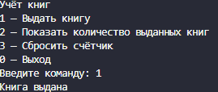
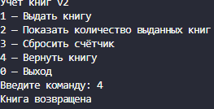

# Проект "Учёт книг"
Простая консольная программа в Python, которая считает, сколько книг сейчас выдано.

## Инструкция
1. Скачать папку.
2.Открыть в VS Code .
3. Запустить программу нажав на кнопку в правом верхнем углу .

## Команды
| Команда | Что делает программа |
|---|---|
| `1` | Выдаёт одну книгу. Счётчик увеличивается на `1` |
| `2` | Показывает, сколько книг выдано |
| `3` | Сбрасывает счётчик до `0` |
| `0` | Завершает работу |
| `4(новая)` | Возвращает книгу |

## v1

## v2
